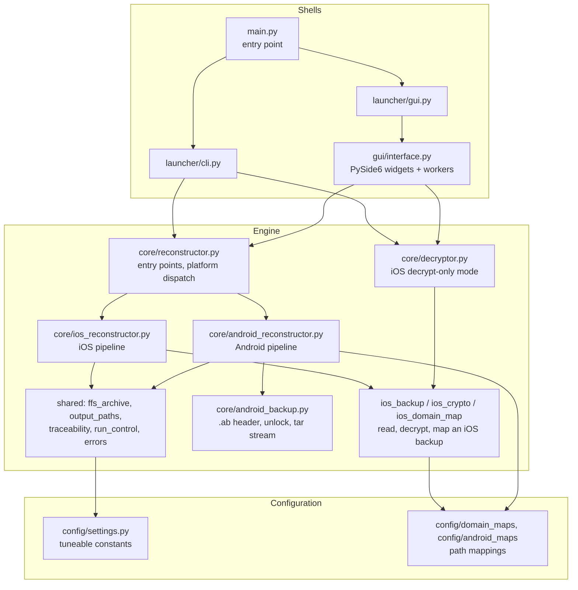
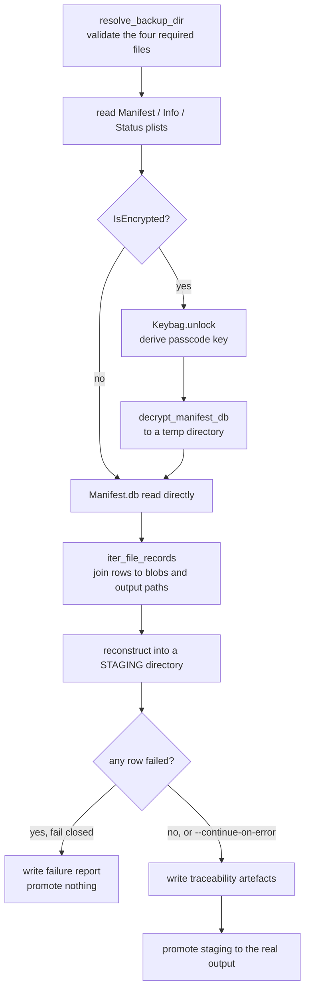

# Architecture

## Layers



Dependencies flow inward. The shells hold no reconstruction logic; the engine
imports no UI code, so it is usable from a CLI, a GUI or a test with equal ease.

## Reconstruction pipeline



### Why staging

Reconstruction writes into a temporary directory beside the destination and
promotes it only once the run has succeeded and the traceability artefacts are
in place. This is what makes "fail closed" real: a failed run leaves no
half-populated output folder that could be mistaken for a complete one.

Because the rows are produced while writing to staging but must describe the
final location, `reconstruct_to_folder` takes a separate `report_root`. Without
it, every `output_path` in the manifest would name a temporary directory that
no longer exists by the time anyone reads it.

## Path safety

Domain and relative-path segments come from the backup and are therefore
untrusted. `sanitise_segment` replaces characters invalid on Windows, prefixes
reserved device names, and strips leading/trailing dots and spaces;
`safe_output_path` and `safe_join_path` drop `..` and absolute segments. Output
paths are always relative to the output root, so a crafted manifest cannot
write outside the folder the operator chose.

`claim_unique_path` then reserves each path, disambiguating genuine collisions
with a `~1` suffix while allowing a directory record to land on a directory
already created as the parent of an earlier file record.

## Module responsibilities

| Module | Responsibility |
| --- | --- |
| `main.py` | Dispatch between GUI and CLI |
| `launcher/cli.py` | Argument parsing, flag validation, progress counter, JSON result and exit codes |
| `launcher/gui.py` | GUI entry point, PySide6-absent handling |
| `gui/interface.py` | Widgets and background workers; no reconstruction logic |
| `core/reconstructor.py` | `reconstruct_backup` / `inspect_backup`: recognise an `.ab` by its header, else treat the input as iOS |
| `core/ios_reconstructor.py` | iOS pipeline: folder and zip writers, dry run, output validation |
| `core/ios_backup.py` | iOS backup directory, plists, `Manifest.db` walk, `FileRecord`s |
| `core/ios_crypto.py` | Keybag, `Manifest.db` and per-file decryption, password handling |
| `core/ios_domain_map.py` | Domain-map YAML loading and domain-to-path mapping |
| `core/ios_traceability.py` | iOS provenance, enriched manifest, zip-root summary |
| `core/traceability.py` | Shared artefact writers: digests, file-manifest CSV, `_traceability/`, failure report |
| `core/run_control.py` | Progress and cancellation contracts, staging and promotion |
| `core/errors.py`, `core/crypto_backend.py`, `core/package_resources.py` | Shared errors, optional `cryptography` loading, package-data lifetime |
| `core/decryptor.py` | iOS decrypt-only mode |
| `core/android_backup.py` | Android `.ab` format: header, password unlock, streamed decrypt/inflate/tar |
| `core/android_reconstructor.py` | Android path mapping, pipeline, provenance and summary |
| `core/ffs_archive.py` | The Full File System-like zip: member writes, root artefacts, hash sidecar |
| `core/output_paths.py` | Path sanitising, collision-free claiming, Windows long paths |
| `core/models.py` | `FileRecord`, `ReconstructionResult` |
| `config/settings.py` | Operator-tuneable constants |
| `config/domain_maps/` | Shipped iOS domain mappings, loaded via `importlib.resources` |
| `config/android_maps/` | Shipped Android path map |

## Testing

`tests/test_ios_backup_reconstruct.py` and `tests/test_android_backup.py` build
synthetic backups in temporary directories (the Android tests write `.ab` files
with an independent implementation of the AOSP writer) — no real evidence data is committed to the repository. The suite
covers both output formats, both layouts, domain-map selection, failure and
`--continue-on-error` behaviour, dry runs, password redaction, and regression
tests for traceability paths, size handling and directory-record collisions.

```bash
uv run python -m unittest discover -s tests
```
